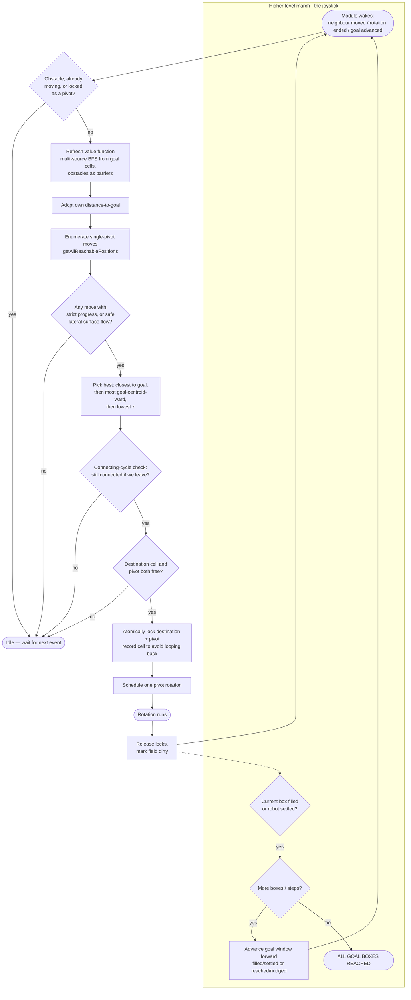

# Million Module March — Catoms3D locomotion

A VisibleSim application that implements the locomotion algorithm of

> R. Fitch and Z. Butler, *"Million Module March: Scalable Locomotion for Large
> Self-Reconfiguring Robots"*, **IJRR** 27(3–4):331–343, 2008.

adapted to 3D catoms (`Catoms3D`). A lattice robot marches across the
environment, over obstacles, toward a sequence of overlapping goal bounding
boxes — when the current box is filled the goal advances and the robot
re-forms beyond it.

## Algorithm (paper → this app)

| Paper (SlidingCube MDP)              | This app (Catoms3D)                                                |
|--------------------------------------|--------------------------------------------------------------------|
| State = lattice position             | FCC lattice cell (`Cell3DPosition`)                                 |
| Action = slide / convex transition   | One pivot **rotation**; legal set = `Catoms3DMotionEngine::getAllReachablePositions` |
| Reward −1/step, 0 in goal (− height) | BFS distance-to-goal field; ties broken toward the goal, then low z |
| DP value function (Bellman backups)  | Converged value function = multi-source BFS from the goal cells     |
| Connecting-cycle mobility check      | Bounded local connecting-cycle search before every move            |
| Test-and-set lock, lower-ID deadlock | Atomic destination-cell + pivot reservation                        |
| Moving goal bounding box             | `Target` + `Target::loadNextTarget()` once a box is filled         |

The **3D-catom motion constraints** are enforced for free: a module only ever
considers cells returned by `getAllReachablePositions`, i.e. positions reachable
by a single, collision-free, connector-valid pivot rotation.

## Step-by-step flow

Each module runs the same loop, re-triggered whenever the structure or goal
changes (a neighbour moves, a rotation ends, or the goal advances). The
higher-level process keeps the goal window marching forward until every box is
reached.



Colours during a run: grey = obstacle, white = rotating, red = reserved as a
pivot, green = placed in the goal, otherwise shaded by distance-to-goal.

## Build (CMake)

From the repository root:

```bash
cmake -B build .
cmake --build build --target millionModuleMarch
```

The binary is written to `applicationsBin/millionModuleMarch/millionModuleMarch`.
(A `Makefile` is also provided for parity with the other `applicationsSrc/*`
apps: `make -C applicationsSrc/millionModuleMarch`.)

## Run

```bash
cd applicationsBin/millionModuleMarch

# GUI:
./millionModuleMarch -c config.xml

# Headless (the run self-terminates once no further motion is possible; -s is
# just a safety cap):
./millionModuleMarch -t -s 80000000 -c config.xml
```

**Self-termination & the position report.** The periodic planner keeps the event
queue alive, so to avoid spinning to the `-s` deadline the run now **stops on its
own** when no rotation has completed for `DEADLOCK_WINDOW` (4 s sim-time) — i.e.
the goal was reached and the body settled, *or* it is genuinely stuck. On stopping
it prints where the robot modules ended up **relative to the obstacle** along the
march axis, so a stalled run is unambiguous:

```
[MMM] *** TERMINATED at t=… -- no further motion possible, goalFinished=… ***
[MMM]     obstacle x=[9,9]  modules before=6 at=3 past=3 (of 12)  --> body did NOT fully pass the obstacle
```

Note `goalFinished=1` in march mode means the goal *window* finished its scripted
steps (it can slide through a wall via nudges even if the body cannot follow); the
`before/at/past` line is the real verdict on whether the body cleared the obstacle.

Module colours: grey = obstacle, white = rotating, red = reserved as a pivot,
green = placed in the goal, otherwise shaded by distance-to-goal.

### Configurations

- **`config.xml`** — small demo: a 2×2×2 cube (8 catoms) marches over a one-tall
  obstacle, fills goal box 1, advances the goal, crosses the obstacle and fills
  goal box 2. Completes end-to-end (`ALL GOAL BOXES REACHED`).
- **`config_cube.xml`** — larger demo: a 3×3×3 cube (27 catoms) marching over a
  two-tall obstacle. The whole robot shifts forward and reaches each box.
- **`config_march.xml`** — *self-generated* marching goal (see below): a 2×2×2
  cube walks several body-lengths over flat ground / a small obstacle with no
  hand-authored boxes.
- **`config_adaptive.xml`** — *clearance-adaptive* marching goal (see below): a
  wide 2×4×2 block marches +x through a vertical slit (3 wide in y) in a wall. The
  goal box senses the passage and **reshapes** — narrowing in y and elongating in
  x (`box=3x3x2`) — threads the slit, then widens back (`box=2x4x2`). Completes
  end-to-end (`ALL GOAL BOXES REACHED`).
- **`config_corridor.xml`** — *narrow/wide corridor*: a 2×5×2 block (20 catoms)
  marches +x through two narrow vertical slits separated by a wide-open region,
  with `clearance="1"`. The goal box tracks the environment —
  `2x5x2 → 3x4x2 → 2x5x2 → 3x4x2 → 2x5x2` — narrowing at each slit and widening
  back between them, threading both and completing end-to-end.
- **`config_split.xml`** — *SPLIT mode*: a block marches +x at a central pillar
  that divides the path into two side openings. The APF infers `mode=split` and
  the goal box spans **both** openings, so the body flows around the divider as a
  connected ring (see *inferred modes* below).
- **`config_ladder.xml`** — *LADDER mode*: a block at a wall whose only opening is
  a square tunnel (constricted in **both** perpendicular axes). The APF infers
  `mode=ladder` (a thin single-file column).

Obstacles are `<block ... obstacle="true"/>`; explicit goal boxes are successive
`<target format="grid">` elements (do **not** put XML comments directly inside
`<targetList>` — the core parser does not skip them).

### Goal modes

The goal can be specified two ways:

1. **Explicit boxes** (`config.xml`, `config_cube.xml`): a `<targetList>` of
   successive `<target>` regions. When one is filled the goal advances to the
   next.

2. **Self-generated marching goal** (`config_march.xml`): *omit* `<targetList>`.
   The goal becomes the robot's own bounding box used as a window that slides
   forward along a chosen axis; the robot continuously re-forms its shape one
   step ahead. This is the paper's flat-ground experiment — *"move forward N
   module widths and reform the cube"* (Section 5.2) — and needs no authored
   boxes. It is driven by `<world>` attributes:

   | attribute     | meaning                                            | default |
   |---------------|----------------------------------------------------|---------|
   | `marchAxis`   | travel axis: `x`/`y` (horizontal), `z` (vertical)  | `x`     |
   | `marchDir`    | `1` (toward +axis) or `-1`                         | `1`     |
   | `marchSteps`  | number of forward steps to walk                    | `3`     |
   | `marchStride` | cells the window advances per step (overlap)       | `1`     |

   Example: `<world gridSize="22,8,7" marchAxis="x" marchSteps="10">`.
   Total distance travelled ≈ `marchSteps × marchStride` cells.

3. **Clearance-adaptive marching goal** (`config_adaptive.xml`): the march
   above, but the goal box is **reshaped to the local free space** instead of
   keeping the robot's bounding box. Add `adaptiveBox="true"` to a march
   `<world>`. Each step the two axes perpendicular to `marchAxis` are sized to
   the sensed passage width (a clearance probe — the artificial-potential-field
   "repulsive distance"), and the box length along `marchAxis` is set so it still
   holds every module (volume ≈ module count). So a **narrow passage** makes the
   box a thin, elongated column that threads through; an **open region** (with
   `maxWidth` set above the natural width) makes it a wide, flat slab — a broader
   moving front that advances faster. The robot simply re-forms into whatever box
   it is handed, so it morphs to fit the environment.

   | attribute    | meaning                                                       | default |
   |--------------|---------------------------------------------------------------|---------|
   | `adaptiveBox`| `true` to reshape the goal box from local clearance           | `false` |
   | `maxWidth`   | cap per perpendicular axis; `0` = keep natural width (narrow-only, never widen) | `0` |
   | `clearance`  | `1`/`true` to keep one empty cell between modules and obstacles (APF repulsive margin) | `false` |

   The box only ever **narrows** to fit a passage unless `maxWidth` opts in to
   widening, the cross-section morphs at most one cell per step (so the gradient
   stays smooth), the box's leading edge stays one body-step ahead while any
   extra length grows *backward* over the body (so the front cannot race ahead
   and smear), and the passage width is sampled over a neighbourhood of the
   centroid (so a single off-centre ray cannot collapse an axis that has
   clearance). This is the APF-as-supervisor idea: the geodesic value function
   still does the (local-minima-free) navigation, while the clearance field
   drives shape/throughput.

   **Obstacle handling.** Two safety rules apply around terrain. (1) An obstacle
   is **never used as a rotation pivot** — catoms only actuate against other
   catoms, never against fixed terrain (this is always on). (2) With
   `clearance="1"` the APF keeps **one empty cell** between the modules and any
   obstacle: cells adjacent to terrain become barriers in the value function, are
   rejected as move destinations, and shrink the sensed passage width — so the
   geodesic routes, and the adaptive box sizes, with a one-cell margin. A slit of
   physical width `w` then offers `w − 2` usable cells (the two edge rows touch
   the wall). Clearance is off by default so the climb-over demos (`config.xml`,
   `config_cube.xml`), where the robot intentionally sits against an obstacle,
   are unaffected.

   In `config_adaptive.xml` (a 5-wide slit with `clearance="1"`) the window
   cleanly goes `2x4x2 → 3x3x2 → 2x4x2` as the body approaches, narrows into the
   3 usable cells, threads the slit without touching the wall, and widens back —
   completing end-to-end.

   **Inferred modes.** Each step a **locomotion mode is inferred from the forward
   APF clearance** and drives how the box is shaped (printed in the advance log,
   e.g. `box=3x3x2 mode=narrow`):

   | mode | clearance signature ahead | goal-box response |
   |------|---------------------------|-------------------|
   | `open`   | room in both ⟂ axes              | natural width (or `maxWidth`) |
   | `narrow` | constricted in **one** ⟂ axis (a slit) | narrow that axis, elongate |
   | `ladder` | constricted in **both** ⟂ axes (a tunnel) | thin single-file column |
   | `split`  | **two** separate openings ahead (a pillar/divider) | box spans **both** openings; body flows around as a connected ring |

   The classifier reads the forward cross-section: per-axis free width
   (`narrow`/`ladder`) and the count of connected cleared openings (`split`, via
   `forwardOpenings`). `split` is handled the connectivity-preserving way — the
   box covers both openings *and* the divider (whose cells are obstacles, never
   seeded), so the body fills around it as a ring without ever disconnecting (it
   keeps the box as deep as the body rather than collapsing to a fragile sheet).

   Mode *inference* is robust and verified for all four (`config_adaptive` →
   open/narrow, `config_ladder` → ladder, `config_split` → split).

   **Sequencing layer (partial).** In the constricted modes (`ladder`/`split`)
   the body otherwise packs against the obstacle and gridlocks, so two metering
   rules engage there (and only there — `open`/`narrow` keep full parallelism):

   - **Surging priority** — a module yields to an adjacent module strictly closer
     to the goal that can itself move, so the throat drains *front-first* (the
     paper's surging order). The globally-closest movable module always has
     right-of-way, so progress is guaranteed.
   - **Uphill escape** — a module trapped with no forward move may step one cell
     *back* in distance but *toward* the goal opening (anti-cycled), to slip out
     of a trap. The paper's MDP allows such non-greedy actions; pure greedy
     descent never would.

   These **substantially improve** throughput through tight constrictions (e.g.
   `config_split` goes from ~3/12 modules through the divider to ~11/20 on a
   larger body) but do **not** yet fully drain them. The remaining trapped
   modules need *multi-step coordinated* maneuvers that single-pivot greedy
   motion cannot express — completing a tight tunnel/divider is a deeper limit of
   the actuation model (it would need lookahead / proper MDP rollout), beyond a
   metering layer. The run now **self-terminates** on this stall and the
   `before/at/past` report shows exactly how far the body got (see *Run*).

   **Passage width vs. throughput.** Even with metering, fully draining a body
   needs the usable opening to admit modules at least two abreast; a passage
   exactly as wide as the narrowed body single-files them and the tail clogs. The
   completing demos (`config_adaptive`, `config_corridor`) are sized so the body
   keeps modules flowing past each other (5-cell slit → 3 usable for a body that
   narrows to 3). The adaptive box (the *what shape*), the inferred mode (the
   *what regime*), and the sequencing (the *which module, in what order*) are
   complementary; this app implements all three, with sequencing partial.

In march mode the goal advances when the robot's trailing edge has translated
into the window (a compact step), or — if the tail momentarily sticks while the
body still overlaps the window — the higher-level process **nudges** the window
forward to pull it loose (the paper's joystick). A small stride keeps each goal
heavily overlapping the body so the robot never strands or runs away.

In explicit-box mode the goal advances when its box is **filled** or the robot
has **settled** (handles the paper's last-module contention). Each advance is
logged as `(reached)` / `(nudged)` (march) or `(filled)` / `(settled)` (boxes).

## Implementation note (realism)

VisibleSim is a single-process discrete-event simulator. The paper's planning is
a *distributed* dynamic program (neighbour-to-neighbour Bellman backups) and its
actuation uses *distributed* test-and-set locking with lower-ID deadlock
resolution. Implemented literally with asynchronous messages, both misbehave on a
constantly-changing structure: the value field oscillates (Bellman-Ford
count-to-infinity) and pivot locks leak when a mover ends a rotation no longer
adjacent to its pivot (livelock).

This implementation therefore realizes the **converged outcome** of those
distributed protocols directly as shared state — the value function is the
multi-source BFS the backups converge to, and the locks are atomic claims (the
single-threaded event loop makes "test, then claim" atomic, which is exactly the
mutual exclusion the locking round provides). The algorithm's *logic* — MDP value
function, greedy policy descent, connecting-cycle connectivity preservation,
destination/pivot locking, obstacle handling and a moving goal — is unchanged.
The local connecting-cycle mobility test is computed over the local neighbourhood
as the paper specifies.
